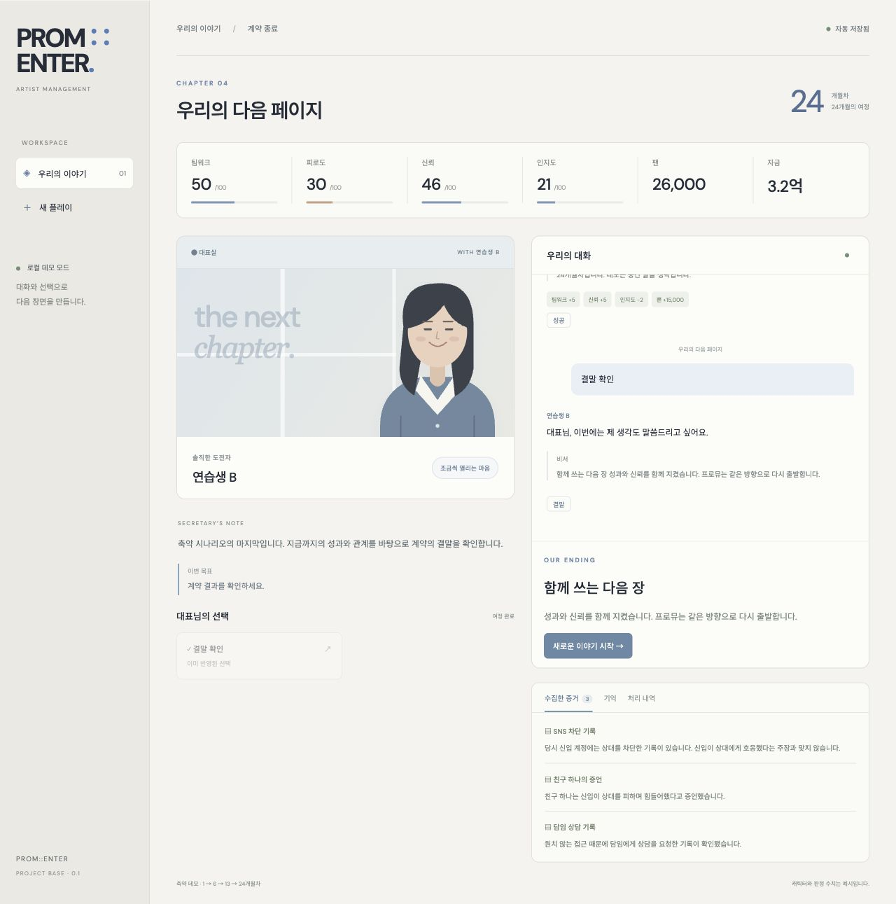

# Prom::Enter — 스토리 게임 프로젝트 베이스

React + TypeScript 화면과 FastAPI 서버를 연결한 실행 가능한 프로젝트 베이스입니다. 캐릭터 선택 → 훈련 → 예능 출연 → 논란 조사 → 엔딩을 플레이하면서 게임 규칙·AI 판단·대화 기억·저장을 확인할 수 있습니다.



**이 저장소는 초안의 모든 스토리를 구현한 완성품이 아닙니다.** 선택 슬롯 A/B/C에는 원문 프로필의 이도/여울/사야를 연결했습니다. 수치, 거절 결과, 엔딩 조건은 기술 검증용으로 작성했습니다. 1 → 6 → 13 → 24개월차를 연결하며, 중간 달과 원안의 연습생 면담은 생략했습니다.

인물 페르소나는 2026-11-02 Notion 수정본을 반영했습니다. 현재 명단은 백하연·리안·도하·세인·여울·이도·사야입니다. [인물 자료와 원문 우선순위](characters/README.md)에서 변경 내용과 이전 원본을 확인할 수 있습니다. 기존 저장용 내부 ID는 유지하며, 콘솔은 `yeoul`·`ido`·`saya` 같은 새 영문 별칭도 받습니다. 실행 중인 서버·콘솔은 재시작해야 새 자료를 읽습니다.

새 시작 화면에는 도입·여울/이도/사야 데모 면담·세 명 완료 후 최종 영입 확인을 추가했습니다. 이 흐름은 브라우저에 저장하며, 위 축약 게임과 실제 AI에는 아직 연결하지 않았습니다. [면담 구현 범위와 연결 지점](docs/interview-demo.md)을 참고하세요.

영입 후에는 멤버 사진이 있는 확정 창, 비서의 프로뮤 결성·다음 목표 안내와 **1개월차 ‘어색한 첫 합숙’ 프론트 데모**가 이어집니다. 훈련 분야·기존 멤버 면담·합숙 규칙을 정하고 첫 달 계획을 확인·저장할 수 있습니다. 게임 수치와 성공/실패는 아직 계산하지 않습니다. [첫 달 구현 범위](docs/month-one-demo.md)를 참고하세요.

## Part 1–2 프로토타입

타이틀의 **Part 2 프로토타입 시작**에서 **후보 면담 시작**을 선택하면 후보 면담 → 최종 선발 → 1~6개월차 활동으로 진행합니다. 결정은 기존 자유 대화와 선택지 모두 지원하며, 등장 화자는 기존 후보/신입과 백하연으로 유지합니다. 면담은 `면담 마무리하자`, 최종 선발은 `사야를 선발해줘`처럼 확정합니다. 화면·행동 예시·프로토타입 판정표와 이전 저장 호환은 [Part 2 안내](docs/part2-prototype.md)를 참고하세요. 아래의 1 → 6 → 13 → 24개월 설명은 `scenario`를 생략한 기존 API 데모 경로입니다.

## 스토리 자료

팀/개인 능력치와 자금의 구분은 [운영 시스템 참고](docs/game-systems-reference.md)를 함께 확인하세요. 새로 제공된 AI ent. 노션의 팀 능력치 네 항목과, 기존 Figma 초기값의 출처를 구분해 정리했습니다.

[Figma 스토리라인 정리](storyline/README.md)에 도입·선발, 1~24개월차 사건, 과거 논란 조사, 엔딩 조건과 기획 확인사항을 정리했습니다. 원문 추출본과 출처도 함께 보존했습니다. 프로듀서 초안과 실행용 데모 규칙은 별개입니다.

## 협업

AI 모듈과 웹(프런트·백엔드)을 나누어 개발합니다. 역할과 Git 사용 방법은 [협업 가이드](docs/git-workflow.md), 에이전트가 따를 규칙은 [AGENTS.md](AGENTS.md)를 참고하세요.

웹 담당자는 [프런트엔드 연결 명세](docs/frontend-integration.md)에서 API·상태·대화 상대·사건 도입·오류 처리 규칙과 변경 이력을 확인하세요. 웹에 영향을 주는 기능 변경 시 이 명세도 함께 갱신합니다.

## 처음 실행

Python 3.12 이상, Node.js 24 LTS, npm이 필요합니다. API 키 없이 기본 데모가 실행됩니다. 아래 명령은 프로젝트 루트에서 실행합니다.

```sh
python3 -m venv backend/.venv
backend/.venv/bin/python -m pip install -e './backend[dev]'
npm --prefix frontend ci
python3 scripts/dev.py
```

- 플레이: http://127.0.0.1:5173
- API 문서: http://127.0.0.1:8000/docs
- 종료: 실행 터미널에서 Ctrl+C. 재시작해도 같은 브라우저에서는 저장된 플레이를 이어갑니다.
- Windows에서는 가상환경 Python을 `backend/.venv/Scripts/python.exe`로 바꿉니다.

설정 변경은 `backend/.env.example`을 `backend/.env`로 복사한 뒤 적용합니다. 수정 후 백엔드를 재시작하세요. 의존성 전체의 검증 시점 버전은 `backend/requirements-dev.lock.txt`와 `frontend/package-lock.json`에 기록합니다.

## 데모에서 확인할 것

캐릭터 선택 직후와 사건이 바뀔 때 대화창에 **시간·장소·상황·백하연의 설명·이번 선택지**가 표시됩니다. 도입 자체는 모델을 호출하지 않으며, 이전 플레이도 현재 사건의 안내를 복원합니다. 상세 계약은 [사건 도입 문서](docs/event-openings.md)에 있습니다.

1. 연습생 선택 후 **예능 훈련 → 활동 확정 → 신입 출연**을 선택하면 훈련 이력에 따라 성공합니다. 휴식만 하고 신입을 출연시키면 실패합니다.
2. 조사 장면에서 **SNS 기록·친구 하나·상담 기록**을 확인합니다. 증거 3개를 모아도 사용자가 최종 대응을 고를 때까지 조사가 계속됩니다.
3. **조사 결과로 신입 보호**를 선택하면 증거 수에 따라 성공·부분 성공·실패가 나뉩니다. 책임 인정 선택은 실패 경로입니다.
4. 계약 장면에서 **결말 확인**을 누르면 결과·팀워크·신뢰에 따라 결말을 계산합니다. 최선의 결말에는 훈련 성공, 조사 성공, 장면별 격려가 도움이 됩니다.
5. 새로고침 후 복원, 이미 실행한 선택의 중복 방지, 기억·증거·처리 내역 탭을 확인합니다.

데모의 자유 입력은 **보수적인 규칙 기반 입력기**입니다. 명시적으로 작성한 한국어 명령 패턴과 제한된 대명사 참조를 처리하며, 일반적인 한국어 의미 이해를 구현했다고 간주하면 안 됩니다. 버튼 이름 또는 지원 명령으로 활동할 수 있고, `네 잘못이 아니야`, `괜찮아, 같이 해결하자`는 격려 예시, `내가 기록을 확인해줄게`는 약속 예시입니다. 미지원 문장은 대화로 처리하거나 되묻습니다. 부정·회상·가정 등의 제한된 오프라인 사례를 검증했고, 일반적인 의미 해석은 실제 모델 및 추가 평가로 검증해야 합니다.

## AI 모듈 단계별 구현

문맥 자료형, 사건별 행동·평가, 7명 캐릭터 자료, 대사 검증, 장기 기억 검색을 연결했습니다. 인터페이스와 한계는 [AI 모듈 문서](docs/ai-module.md)를 참고하세요.

```sh
backend/.venv/bin/python scripts/evaluate_ai.py
```

기본 평가는 유료 모델을 호출하지 않습니다. 분석 28개와 사람 검토용 대사 5개를 사용합니다. 자동 통과는 일반적인 자연어 이해나 대사 품질의 보증이 아닙니다.

## 실제 AI 연결

`backend/.env`에 다음을 설정합니다.

```dotenv
AI_PROVIDER=openai
OPENAI_API_KEY=전달받은_키
OPENAI_MODEL=사용_가능한_구조화_출력_지원_모델_ID
OPENAI_REASONING_EFFORT=none
```

모델 ID는 사용 계정에서 이용 가능한 모델로 직접 지정합니다. 기본 모델을 임의로 고정하지 않았습니다. 키는 서버에만 두고 `VITE_` 변수나 브라우저 코드에 넣지 마세요. 실제 키를 `.env.example`에 쓰지 않습니다.

`OPENAI_REASONING_EFFORT`는 분석과 대사 생성 모두에 적용됩니다. 빈 값이면 모델 기본값을 사용하고, `none`은 추론을 사용하지 않도록 명시하는 값입니다. 허용 값은 모델마다 다르며, 현재 예시 모델 `gpt-6-luna`는 `none`, `low`, `medium`, `high`, `xhigh`, `max`를 지원합니다. 설정 변경 후 서버나 콘솔을 다시 시작하세요. [OpenAI 모델 문서](https://developers.openai.com/api/docs/models/gpt-6-luna)

OpenAI 모드의 일반 공개 자유 입력은 분석 1회와 화자별 대사 생성 2회로 총 3회, 선택지는 생성 2회입니다. 1:1 대화와 캐릭터 콘솔의 일반 입력은 해석 1회 + 생성 1회입니다. 자연어 상대 전환과 대상 되묻기는 해석 1회만 호출하고, 명시적 상대 선택은 호출하지 않습니다. 서로 다른 인물의 지식을 한 모델 요청에 합치지 않습니다. `responses.parse`와 Pydantic 형식을 사용하고, 거절·불완전 출력·시간 초과는 저장 전 실패로 처리합니다. 실패를 데모 답변으로 바꾸지 않습니다. `store=False`, 요청당 25초 제한, SDK 자동 재시도 0회로 시작합니다. 이 값과 모델 설정은 실제 품질·지연·비용을 확인한 뒤 조정하세요.

참고한 API 계약: [OpenAI Structured Outputs](https://developers.openai.com/api/docs/guides/structured-outputs).

## 화면 없이 캐릭터와 대화하기

서버·프런트를 실행하지 않고 7명 모두와 터미널에서 대화할 수 있습니다. 프로젝트 루트에서 실행하며, `backend/.env`의 키·모델·effort를 읽습니다.

```sh
# 설정 유무와 캐릭터 목록 확인: API 호출 없음
backend/.venv/bin/python scripts/chat_character.py --check
backend/.venv/bin/python scripts/chat_character.py --list

# 실제 모델로 대화: 일반 입력은 해석 1회 + 생성 1회 과금
backend/.venv/bin/python scripts/chat_character.py --character 백하연
backend/.venv/bin/python scripts/chat_character.py --character 여울

# 단일 질문과 선택적 기록 저장 (기존 파일 덮어쓰기 안 함)
backend/.venv/bin/python scripts/chat_character.py --character 이도 --message '요즘 연습은 어때?' --output backend/data/hyerin-review.json
```

이 콘솔은 `AI_PROVIDER=demo`여도 기본적으로 **실제 OpenAI 모델**을 사용합니다. 키 없이 동작만 확인하려면 `--provider demo`를 지정하세요. 데모 응답은 페르소나 품질 평가용이 아닙니다.

`/character 사야`로 대상을 바꾸면 최근 대화창은 비워지지만, 각자가 습득한 정보는 실행 중 유지됩니다. `/profile`은 기본 프로필·말투, `/knowledge`는 현재 인물이 대화에 사용할 수 있는 정보와 출처를 보여줍니다. `/trust 80`과 `/fatigue 70`은 테스트용 심경 조건, `/scene 상황 설명`은 장면을 바꿉니다. `/config`로 현재 설정을 확인하고 `/save backend/data/review.json`으로 기록을 저장합니다. `/reset`은 전체 습득 정보와 현재 대화를 초기화하며 `/quit`으로 종료합니다.

대화 맥락과 인물별 지식은 실행 중 유지됩니다. 스탯은 자동으로 변하지 않고 게임 사건·보상·엔딩·DB 저장을 실행하지 않습니다. 숨겨진 과거사 자료는 잠긴 상태이며, 저장한 JSON을 불러와 이어 하는 기능은 없습니다. `/profile`·`/knowledge`와 JSON 내보내기는 개발용이며 플레이어용 화면에 노출하는 기능이 아닙니다.

회사 공통 인물 정보(이름·설정상 나이·포지션·기존 데뷔조/신입 후보 구분)는 모든 대화에 전달합니다. 백하연에게 `멤버들 이름, 나이, 포지션을 정리해줘`라고 물어 확인할 수 있습니다. 콘솔에는 다른 멤버의 오늘 피로도나 훈련 진행 상태가 없으므로, 이런 최신 현황은 만들어 답하지 않습니다.

`사야랑 얘기하고 싶어`, `백 실장 연결해줘`처럼 자연어로도 콘솔 상대를 바꿀 수 있습니다. 성공하면 `[시스템] 대화 상대를 변경했습니다`를 출력하고 다음 입력부터 새 인물이 답합니다. `사야 특징 알려줘`처럼 인물을 언급한 것만으로는 바꾸지 않고, `연결해줘`처럼 모호하면 상대를 되묻습니다. 콘솔은 7명 모두와 1:1 대화할 수 있으며 공개 그룹 대화는 지원하지 않습니다.

성향 정보는 인물별로 다릅니다. 초기 인지 범위는 [knowledge-policy.json](characters/knowledge-policy.json)에서 수정하고 `scripts/compile_characters.py`를 다시 실행합니다. 예를 들어 백하연에게만 별명을 알려준 뒤 `/character 이도`로 바꾸면 이도는 그 발언을 전달받지 않습니다. 자세한 권한·정보 습득·공개 조건은 [인물별 지식 시스템](docs/character-knowledge.md)에 있습니다.

## 모듈과 확장 위치

| 위치 | 역할 |
|---|---|
| `frontend/src/App.tsx` | 선택·장면·대화·상태·기록 UI 및 재시도 |
| `frontend/src/types.ts` | 프런트의 API 데이터 형식 |
| `backend/app/models.py` | 상태·입력·모델 출력 계약 |
| `backend/app/content/demo.json` | 사건·선택지·결과표·증거·캐릭터·엔딩 조건 |
| `backend/app/ai/context.py` | 현재 사건과 최근 8턴·기억을 분석용/연기용으로 구성 |
| `backend/app/ai/providers.py` | 데모/실제 모델, 프롬프트, 근거 발화·허용 행동 검증 |
| `backend/app/game/engine.py` | 행동 검증, 순수 상태 계산, 스탯 반영, 감정 방향, 엔딩 |
| `backend/app/repository.py` | SQLite, 소유자 확인, 요청 중복 방지, 상태 버전 검사 |
| `backend/app/service.py` | 분석 → 게임 계산 → 표현 → 생성 → 저장 연결 |
| `backend/app/main.py` | HTTP·설정·익명 플레이 쿠키 |

공통 수치·보상은 콘텐츠 데이터에서 수정합니다. 사건별 의미가 다른 로직은 `resolver`에 대응하는 게임 함수에서 확장합니다. 복잡한 사건이 늘어나면 현재 엔진의 resolver 분기를 개별 모듈/함수 레지스트리로 분리하세요. 사건 종료에는 사용자의 명시적 결정을 사용하고, 반복 획득 가능한 증거·대화 보상은 고유 키로 제어합니다.

CharacterDirector는 `ai/director.py`, 기억 선택·약속 이행은 `ai/memory.py`와 게임 엔진, 엔딩 판정은 게임 엔진의 `determine_ending`이 담당합니다. 상세 연결 계약은 [AI 모듈 문서](docs/ai-module.md)에 있습니다.

## API와 저장

- 현재 대화방은 `conversation`으로 반환합니다. 육성 대상 `character`와 구분하며, 대화방 ID·모드·대상·참여자 이름·선택 가능한 상대가 포함됩니다. 생성·조회 응답은 `conversation`, 턴 응답은 `game.conversation`을 기준으로 화면을 갱신합니다.
- 사건 도입은 `event_openings`로 반환합니다. 시작 안내는 대화 앞에, 다음 사건 안내는 `after_turn_id`가 가리키는 결과 턴 뒤에 표시합니다. 일반 턴과 분리해 저장하므로 사용자 입력이나 행동 근거로 취급하지 않습니다.
- 웹 대화창의 **대화 상대** 선택에서 함께 대화 / 현재 신입과 1:1 / 백하연과 1:1로 전환합니다. 서버가 전환을 확정한 뒤 표시하며 새로고침 후에도 복원합니다. 세부 계약과 예시는 [대화 세션 문서](docs/conversation-session.md)를 참고하세요.
- `POST /api/games`: `character_id`로 생성. HttpOnly·SameSite 쿠키로 익명 소유자를 구분합니다.
- `GET /api/games/{id}`: 이 브라우저 소유 플레이의 상태와 대화 복원.
- `POST /api/games/{id}/turns`: `request_id`, `state_version`, `input_type`, `text` 또는 `action_id`.
- 지속되는 상대 변경은 턴 API에 `input_type=conversation`, `conversation_mode`, `target_character_id`로 요청합니다. 자유 입력의 자연어 전환 의도도 해석 후 동일한 서버 검증·저장 경로로 연결합니다. 이후 입력은 저장된 방을 사용합니다. 프런트의 명시적 선택은 모델을 호출하지 않습니다.
- 기존 `recipient_id`는 이번 자유 대화만 대상을 지정하는 호환 경로입니다. 저장된 대화방은 바꾸지 않으며 실제 턴의 청중은 `turn.conversation`에 표시합니다.
- 서버가 실제 상태를 읽고 계산합니다. 브라우저가 보낸 스탯은 사용하지 않습니다.
- 같은 요청 ID와 같은 내용은 저장된 턴을 재사용합니다. 같은 ID를 다른 내용에 재사용하면 409입니다.
- 상태 버전 검사·상태 변경·응답 기록은 한 트랜잭션입니다. 모델 호출 중 DB 쓰기 잠금을 잡지 않습니다.
- 새 버전의 콘텐츠로 기존 저장을 자동 해석하지 않습니다. 현재는 버전 불일치를 알리고 새 플레이를 요구하며, 실제 운영에서는 마이그레이션이 필요합니다.

SQLite 파일은 기본 `backend/data/game.sqlite3`입니다. 영속 디스크가 없는 호스팅에 그대로 올리지 마세요. 브라우저 저장에는 최근 플레이 ID만 있고, 쿠키가 사라지면 기존 플레이에 접근할 수 없습니다. 기기 간 이어하기·로그인·플레이 삭제/내보내기는 아직 없습니다.

## 검증

```sh
cd backend
.venv/bin/python -m pytest -q
```

```sh
npm --prefix frontend run build
```

자동 테스트는 성공/부분 성공/실패, 중복 요청·경합, 소유자 분리, 모델 실패 시 저장 방지, 허구의 행동·발화 근거 거부, 단서 비공개, 약속과 실행 구분, 반복 보상 제한, 순수 상태 계산을 확인합니다. 실제 OpenAI 요청은 테스트에서 발생하지 않습니다.

## Docker로 실행

```sh
docker compose up --build
```

http://127.0.0.1:8080 에서 확인합니다. 프런트와 `/api`는 같은 출처로 제공되며 SQLite는 이름 있는 볼륨에 보관합니다. 실제 AI 환경 변수는 루트 `.env` 또는 실행 환경으로 전달합니다. 공개 배포 전에는 HTTPS, Secure 쿠키, 요청·사용량 제한, 인증과 저장 정책을 별도로 적용하세요.

## 현재 한계

- 실제 모델의 짧은 캐릭터 대화는 별도로 점검할 수 있지만, 장기 대화 품질·전체 게임 판단·비용을 체계적으로 평가한 상태는 아닙니다.
- 구조화된 출력·원문 근거 검사는 의미 판단의 정확성을 보증하지 않습니다. 부정·가정·회상·악의적 입력·캐릭터 일관성 평가 자료가 필요합니다.
- 자료 검색은 공개 조건을 먼저 확인하는 단어·한국어 글자 쌍 기반 검색입니다. 벡터 RAG·임베딩 인덱스는 포함하지 않았습니다.
- 답변 이미지는 감정 태그에 따른 예시 SVG 선택입니다. 임베딩 기반 이미지 유사도 선택은 구현하지 않았습니다.
- 장기 기억은 원본 턴에 연결된 구조화 기록과 관련 기록 검색이며, LLM 요약은 아직 없습니다. 캐릭터별 비공개 기억을 분리하지만 현재 화면에는 신입과 비서만 등장합니다.
- 현재 감정 연출은 신뢰·피로·직전 결과와 짧게 지속되는 복합 감정에 기반합니다. 인물별 독립 능력치·관계 수치와 더 세밀한 연출은 게임 상태 확장이 필요합니다.
- 실시간 스트리밍, 음성, 전용 게임 렌더러는 포함하지 않았습니다. 서버 응답 전체를 검증·저장한 뒤 표시합니다.
