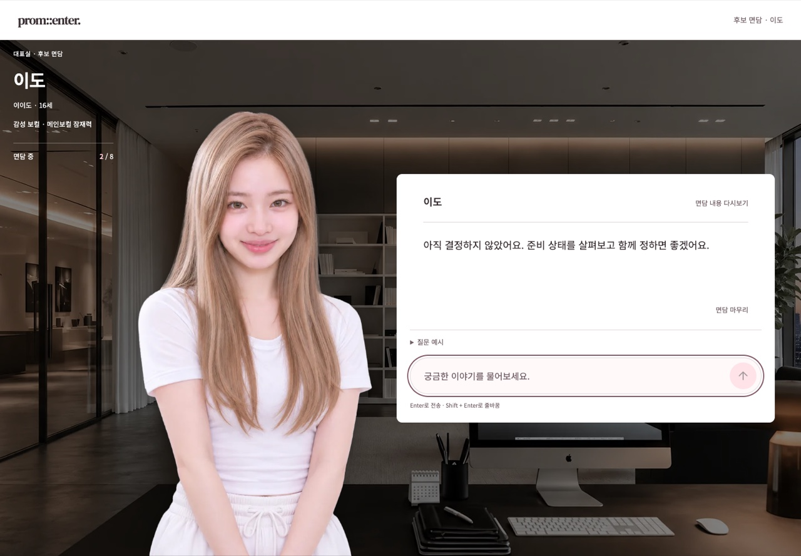
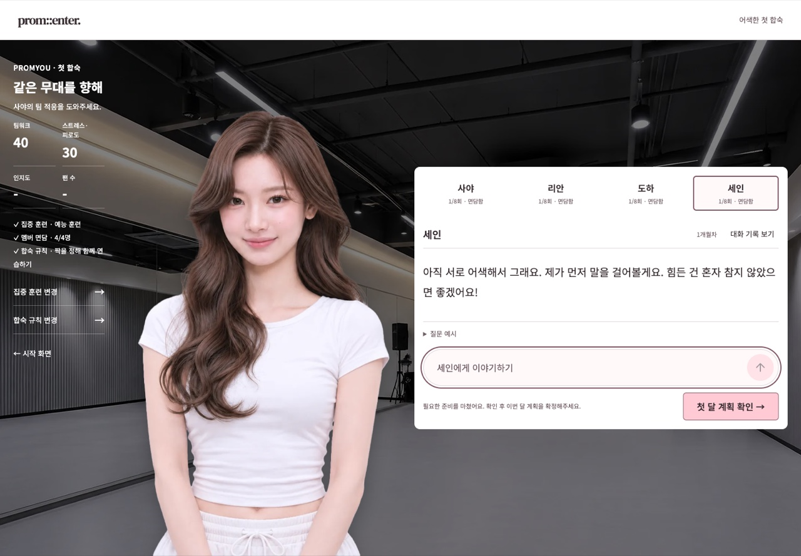

# Prom::Enter

## 프로젝트 소개

Prom::Enter는 엔터테인먼트 회사 대표가 되어 신인 아이돌 그룹을 운영하는 AI 대화형 스토리 게임입니다. 이도·여울·사야를 직접 면담하고 한 명을 영입해 기존 멤버 리안·도하·세인과 팀을 결성합니다. 비서 백하연의 브리핑을 듣고 멤버와 대화하며, 훈련·홍보·위기 대응에 관한 선택으로 24개월 뒤 그룹의 결말을 만들어 갑니다.

[웹에서 플레이하기](https://prom-enter.ajy720.me)

## 화면 미리보기


| 후보 면담 | 1개월차 활동 |
| --- | --- |
|  |  |

로컬 데모에서 캡처했습니다. 인물·배경 이미지의 원본과 출처 기록은 [인물 이미지 안내](frontend/public/images/characters/README.md)와 [장면 이미지 안내](frontend/public/images/scenes/README.md)에서 확인할 수 있습니다.

## 주요 기능

- **면담과 영입** — 세 후보에게 자유롭게 질문하고, 팀에 합류할 한 명을 고릅니다. 후보별 대화 기록을 유지합니다.
- **24개월 운영** — 훈련·합숙·센터 선정부터 홍보 예산, 컴백, 논란 조사, 앨범 제작과 재계약까지 진행합니다. 선택과 면담 결과가 능력치·팀워크·팬 수·자금과 후속 사건에 반영됩니다. 일부 위기 대응은 조기 결말로 이어집니다.
- **상황에 맞는 캐릭터 대화** — 현재 사건, 화자가 알 수 있는 사실, 관련 대화와 약속을 문맥에 넣습니다. 응답의 화자와 표정에 맞는 캐릭터 사진을 표시합니다.
- **이어하기** — 같은 브라우저에서 최근 게임을 이어갈 수 있습니다. 서버는 진행과 턴 기록을, 브라우저는 읽는 위치와 일부 입력 초안을 보관합니다.

## 아키텍처와 데이터 흐름

1. **React 화면 → FastAPI** — 선택지 또는 자유 입력을 게임 ID, 요청 ID, 상태 버전과 함께 `POST /api/games/{game_id}/turns`로 보냅니다.
2. **게임 상태와 대화 문맥 조회** — 서버가 소유자 쿠키와 저장 상태를 확인합니다. 현재 사건, 허용된 행동, 최근·관련 대화와 기억에서 화자·청중이 접근할 수 있는 정보를 모읍니다.
3. **입력 해석 → 서버 판정** — 자유 입력은 `demo` 또는 `openai` provider가 의도와 근거를 해석합니다. 선택지 입력은 서버가 허용된 행동인지 확인합니다. 게임 엔진이 최종 상태와 사건 전환·결말을 계산합니다.
4. **대사 생성 → 저장 → 화면 표시** — 결과를 바탕으로 대사가 필요한 경우 생성하고 응답 구조·참조 권한을 검증합니다. 성공하면 SQLite 트랜잭션으로 상태와 턴을 함께 저장합니다. 프런트는 응답의 화자·표정에 대응하는 WebP와 판정 결과를 표시합니다.

같은 요청의 재전송에는 저장한 턴을 돌려줍니다. 다른 화면이 먼저 진행한 경우에는 버전 충돌을 반환해 최신 상태를 다시 조회합니다. [AI 모듈](docs/development/ai-module.md) · [프런트엔드 연결 명세](docs/development/frontend-integration.md) · [통합 플레이](docs/development/unified-playthrough.md)

## 기술 스택과 선택 이유

| 기술 | 프로젝트에서 맡는 역할 |
| --- | --- |
| React · TypeScript · Vite | 도입·면담·월별 장면에서 채팅과 인물 표시를 재사용하고, API 응답과 장면별 상태를 타입으로 관리합니다. Vite로 로컬 개발과 정적 빌드를 실행합니다. |
| Python · FastAPI · Pydantic | 게임 규칙과 AI 호출을 서버에 모으고 HTTP 요청·응답과 모델 출력의 구조를 검증합니다. FastAPI의 API 문서에서 웹·AI 연결 계약을 확인할 수 있습니다. |
| SQLite | 한 서버에서 게임 상태·턴·요청 이력을 관리합니다. 별도 DB 서버 없이 실행할 수 있고, 상태와 기록을 한 트랜잭션으로 확정합니다. |
| OpenAI · 규칙 기반 데모 | OpenAI는 자유 발화 해석과 캐릭터 대사를 생성합니다. 같은 게임 경로를 API 키 없이 재현할 때는 데모 provider를 사용합니다. |
| Docker Compose · Nginx · GitHub Actions | 프런트와 API를 같은 주소로 제공하고, 컨테이너가 교체되어도 볼륨에 플레이 기록을 유지합니다. `main` 변경은 Actions로 개인 서버에 배포합니다. |

## 실행 및 테스트

Python 3.12 이상, Node.js 24 LTS, npm이 필요합니다. 프로젝트 루트에서 실행합니다. 기본값인 `AI_PROVIDER=demo`에는 API 키가 필요 없습니다.

```sh
python3 -m venv backend/.venv
backend/.venv/bin/python -m pip install -e './backend[dev]'
npm --prefix frontend ci
python3 scripts/dev.py
```

플레이 화면에서 **게임 시작**을 누르면 도입부터 후보 면담·영입과 월별 운영으로 이어집니다. 종료는 Ctrl+C입니다. Windows에서는 가상환경 Python 경로를 `backend/.venv/Scripts/python.exe`로 바꿉니다. [플레이 화면](http://127.0.0.1:5173) · [API 문서](http://127.0.0.1:8000/docs)

실제 AI를 연결하려면 예시 파일을 `backend/.env`로 복사하고 `AI_PROVIDER=openai`, `OPENAI_API_KEY`, `OPENAI_MODEL`을 설정합니다. `OPENAI_REASONING_EFFORT`는 모델에 맞게 선택하고, 저장 경로 변경이 필요하면 `DATABASE_PATH`를 지정합니다. API 키는 서버 환경 변수에 보관합니다. [환경 변수 예시](backend/.env.example) · [실제 AI 설정](docs/guides/setup.md#환경-변수와-실제-ai-연결)

Docker로 실행하려면 `docker compose up --build`를 실행하고 8080번 포트로 접속합니다. [Docker 플레이 화면](http://127.0.0.1:8080) · [Docker 실행 안내](docs/guides/setup.md#docker-실행) · [배포 가이드](docs/guides/personal-server.md)

```sh
backend/.venv/bin/python -m pytest -q backend/tests deploy/tests
npm --prefix frontend test
npm --prefix frontend run build
backend/.venv/bin/python scripts/evaluate_ai.py

# macOS · Linux에서 Playwright Chromium 최초 설치
(cd frontend && PLAYWRIGHT_BROWSERS_PATH=node_modules/.cache/ms-playwright npx playwright install chromium)
npm --prefix frontend run test:e2e
```

E2E는 데모 API(18000번)와 프런트(5179번)를 띄워 PC와 모바일 에뮬레이션에서 진행합니다. Windows는 기본적으로 Edge를 사용합니다. 데모 해석에서는 “예능 훈련”이 훈련 행동으로, “예능 훈련 할까?”와 “예능 훈련 하지 마”는 대화로 처리되는지 확인합니다. [테스트와 AI 평가](docs/guides/testing.md)

## 개발 중 문제와 해결

| 문제와 원인 | 해결 |
| --- | --- |
| 6개월 결산 뒤 브라우저 데모와 서버 진행의 규칙·저장이 달라 이후 선택이 하나의 게임에 이어지지 않았습니다. | 기존 7~24개월 화면과 월별 흐름을 유지하고 판정·보상·저장을 서버에 연결했습니다. 6→7개월 전환에서 같은 게임 ID, 멤버, 누적 기록을 이어갑니다. [통합 변경](https://github.com/ajy720/prom-enter/pull/42) |
| 턴을 저장한 뒤 응답이 유실되면 사용자가 같은 선택을 다시 보낼 수 있었습니다. | 프런트가 원본 입력과 요청 ID를 보존하고 서버가 같은 요청의 기존 응답을 돌려줍니다. 버전 검사와 트랜잭션으로 재전송이나 다른 탭의 오래된 상태가 보상·비용을 중복 반영하지 않게 했습니다. [재시도 규칙](docs/development/unified-playthrough.md#오류와-중복-처리) |
| 시작 사진의 용량이 컸고, WebP 도입 후 PNG까지 포함한 배포 묶음이 서버의 128 MiB 수신 한도를 넘었습니다. | 첫 사진을 먼저 요청하고 이후 전환 컷을 불러오도록 했습니다. 같은 이름의 WebP가 있는 원본 PNG는 배포 묶음에서 제외하고 Git에 보관합니다. [이미지 최적화](https://github.com/ajy720/prom-enter/pull/51) · [배포 수정](https://github.com/ajy720/prom-enter/pull/54) |

## 개선 결과와 검증 방법

2026-11-12 기준으로 백엔드·배포 자동 테스트 384건, 프런트 단위 테스트 144건과 프로덕션 빌드가 통과했습니다.

- **시작 사진 용량** — 같은 원본 폭(1536px)의 시작 사진 세 장을 합산했습니다. PNG 7,256,285바이트에서 WebP 375,332바이트로 약 94.8% 줄었습니다. PC·모바일 Playwright는 첫 이미지 요청 뒤 전환 컷을 요청하는 순서와 동작 줄이기 설정을 검사합니다. [시작 화면 테스트](frontend/e2e/title.spec.ts)
- **진행과 복원** — 통합 E2E는 시작 화면에서 후보를 선발한 뒤 5개월차 예산, 12개월차 신인상과 소감, 후반부 논란 대응, 24개월차 계약 결말을 확인합니다. 새로고침과 응답 유실을 재현해 진행 복원과 동일 요청의 중복 반영 방지도 검사합니다. [플레이 테스트](frontend/e2e/playthrough.spec.ts)
- **오프라인 AI 평가** — 데모 provider로 입력 해석 28건과 대사 출력 7건의 자동 검사 35건을 통과했습니다. 해석은 행동·발화 유형·근거 등을, 대사는 응답 구조와 참조 범위를 확인합니다. 대사의 자연스러움은 사람 검토 항목입니다. [평가 스크립트](scripts/evaluate_ai.py)

## 알려진 제한과 다음 개선점

- 데모의 자유 입력은 지원하는 한국어 표현 패턴을 중심으로 해석합니다. 실제 모델의 장기 대화, 인물별 말투, 단서 공개 범위는 낯선 표현과 여러 달에 걸친 플레이를 대상으로 추가 평가가 필요합니다.
- 일부 월별 판정과 보상은 시연 기준으로 구현했습니다. 성공·실패가 이후 예산, 성장, 계약 결말에 미치는 누적 효과를 여러 경로에서 점검해야 합니다. [월별 판정표](docs/development/monthly-server-rules.md)
- 이어하기는 같은 브라우저의 소유자 쿠키와 서버 저장에 의존합니다. 기기 간 저장 이전과 콘텐츠 버전 변경 시 기존 저장을 옮기는 기능은 구현 과제로 남아 있습니다.
- 월 전환 애니메이션 E2E는 7개월차 결산 화면의 이전 버튼 위치를 찾다가 PC·모바일에서 시간 초과가 발생했습니다. 현재 결산 화면의 `8개월차로` 버튼을 기준으로 테스트를 갱신해야 합니다. [월 전환 테스트](frontend/e2e/month-transition.spec.ts)

## 회고

초기에는 후반 장면을 브라우저 데모에서 빠르게 검토할 수 있었지만, 서버에 연결할 때 화면의 진행 순서와 서버 판정표를 다시 대조해야 했습니다. 특히 월말 보상과 다음 달 진입은 같은 화면을 보여줘도 판정과 저장 시점에 따라 결과가 달라졌습니다. 다음 사건을 추가할 때는 화면 흐름과 함께 행동 ID·판정 조건·보상 적용 시점·새로고침 후 복원 지점을 먼저 합의하고, 한 달의 시작부터 결산까지 API와 화면을 함께 확인하겠습니다.

AI와 웹 작업은 [프런트엔드 연결 명세](docs/development/frontend-integration.md)로 맞춥니다. 코드 위치와 개발 자료는 [문서 안내](docs/README.md), 브랜치와 PR 절차는 [협업 가이드](docs/development/git-workflow.md)를 참고하세요.
