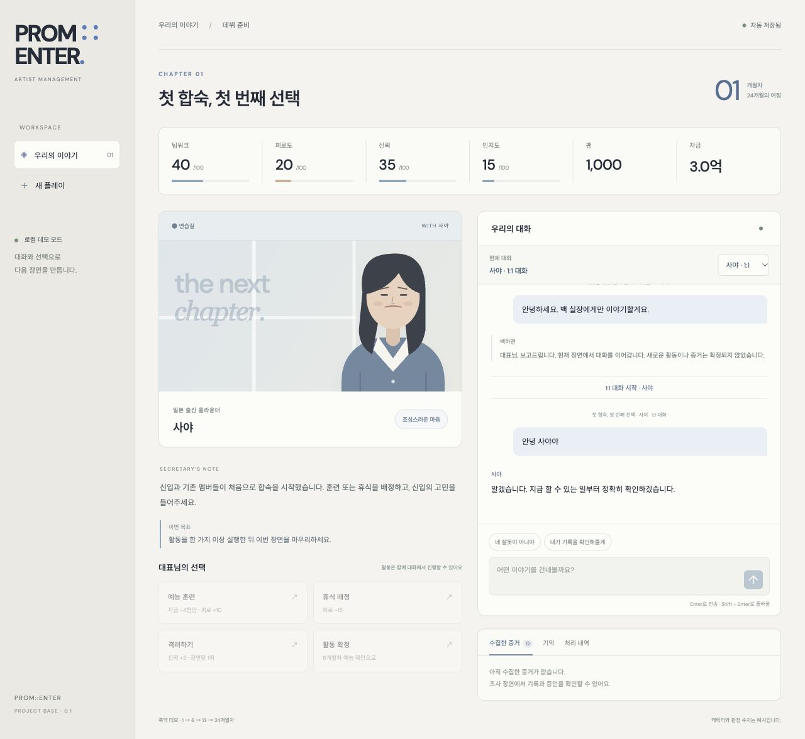
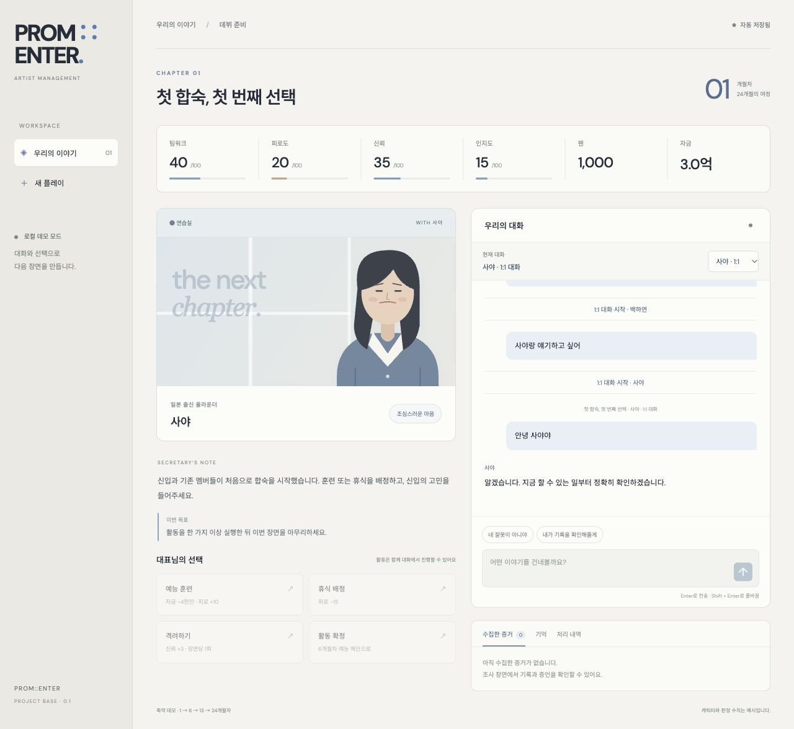

# 현재 대화방과 상대 전환

`game.character`는 육성 대상 신입입니다. `game.conversation`은 지금 누구와 이야기하는지를 나타냅니다. 대화 상대를 바꿔도 육성 대상·게임 사건·스탯·기존 기억을 바꾸지 않습니다.



## 프런트가 읽는 응답

플레이 생성과 조회는 최상위 `conversation`, 턴 응답은 `game.conversation`에 현재 방을 포함합니다. 예를 들어 사야를 육성하면서 백하연과 면담하는 응답은 아래 형태입니다. ID는 예시입니다.

```json
{
  "character": {"id": "c", "name": "사야"},
  "conversation": {
    "id": "a-stable-room-uuid",
    "mode": "private",
    "target_character_id": "baek_hayeon",
    "participants": [
      {"id": "player", "name": "대표", "role": "player", "portrait_url": null},
      {"id": "baek_hayeon", "name": "백하연", "role": "secretary", "portrait_url": "/portraits/hopeful.svg"}
    ],
    "available_targets": [
      {"id": "jiwoo", "name": "사야", "role": "newcomer", "portrait_url": "/portraits/hopeful.svg"},
      {"id": "baek_hayeon", "name": "백하연", "role": "secretary", "portrait_url": "/portraits/hopeful.svg"}
    ]
  }
}
```

공개 대화는 `mode=public`, `target_character_id=null`이고 참여자가 대표·현재 신입·백하연입니다. 현재 축약 시나리오의 전환 가능 상대는 선택한 신입과 백하연입니다. 다른 멤버의 대화 가능 시점은 `game/conversation.py`의 서버 정책에서 확장합니다. 위 초상화는 기존 예시 SVG이며 실제 인물별 이미지가 아닙니다.

프런트는 `available_targets`로 선택 목록을 만들고, 서버가 반환한 현재 방으로 표시를 갱신합니다. 대사 텍스트에서 상대 이름을 추측하지 않습니다. 이전 턴의 `turn.conversation`은 당시 방·참여자 이름의 스냅샷이며 현재 방을 덮어쓰는 데 사용하지 않습니다. 과거 기록은 대화방별 캡션을 붙여 같은 타임라인에 표시합니다.
새 프런트는 `conversation` 응답이 필요하므로 백엔드를 먼저 갱신하거나 함께 재시작합니다. 새 백엔드는 기존 프런트의 요청도 계속 처리합니다.

## 명시적 상대 전환

기존 턴 API `POST /api/games/{game_id}/turns`를 사용합니다.

```json
{
  "request_id": "unique-switch-request-001",
  "state_version": 3,
  "input_type": "conversation",
  "conversation_mode": "private",
  "target_character_id": "baek_hayeon"
}
```

함께 대화로 돌아갈 때는 `conversation_mode=public`, `target_character_id=null`로 보냅니다. 요청에는 대화 내용·활동·`recipient_id`를 섞지 않습니다. 전환 후 일반 자유 입력은 `recipient_id` 없이 보내도 저장된 방의 상대에게 전달됩니다.

서버가 소유자·버전·플레이 종료 여부·대상·모드를 검증합니다. 허용하지 않은 대상은 422, 오래된 상태 버전과 종료된 플레이는 409입니다. 현재 데이터에는 선택한 신입과 비서만 등장하므로 다른 인물의 ID를 보내도 면담이 열리지 않습니다.

명시적 전환은 모델을 호출하지 않습니다. DB에서 새 방과 버전을 확정한 뒤 `kind=conversation_change`인 서버 알림을 기록하고 응답합니다. 알림은 사용자 발언이나 NPC 발언으로 AI 문맥·지식에 넣지 않습니다. 동일 요청 재시도는 기존 기록을 재사용하며, 같은 ID에 다른 내용을 넣으면 409입니다. 프런트는 요청 ID와 버전을 유지한 채 재시도합니다. 실패하면 기존 상대를 표시하고 다른 요청을 막아 재시도할 수 있게 합니다.

같은 참여자의 방으로 돌아오면 동일한 방 ID를 사용합니다. 이전 대화와 인물별 지식을 지우지 않습니다. 서버에 저장된 상태로 새로고침·서버 재시작 후 복원합니다. 스탯을 변경하는 게임 활동은 공개 대화에서만 가능하며, 1:1에서는 웹 버튼을 비활성화하고 직접 활동 요청도 422로 거부합니다.

## 기존 데이터와 요청 호환

- 이전 저장에 `conversation`이 없으면 안정적인 ID의 기본 공개 방을 응답합니다. GET으로 원본을 수정하지 않고 다음 정상 쓰기 때 저장합니다.
- 기존 `recipient_id`는 **이번 턴만** 대상을 지정합니다. 저장된 방은 바꾸지 않습니다. 이 경우 `turn.conversation`은 이번 턴의 실제 1:1 청중이고 `game.conversation`은 계속 유지되는 방입니다. 새 프런트는 지속 전환 요청을 사용합니다.
- 새로운 선택 필드를 생략한 요청의 fingerprint는 과거 형식을 유지합니다. 지연된 이전 요청의 재시도는 과거 턴과 **현재** 게임 상태를 반환하므로 과거 상대가 현재 상대를 되돌리지 않습니다.
- 예전 턴에 방 스냅샷·종류가 없더라도 화면에서 읽습니다. 추가 상태는 SQLite의 기존 JSON에 저장하므로 테이블을 지우거나 스키마를 파괴적으로 변경하지 않습니다.

## 자연어 전환과 콘솔

일반 `input_type=chat`으로 “사야랑 얘기하고 싶어”, “백 실장 연결해줘”, “함께 대화로 돌아가자”를 보내면 입력 해석의 `Analysis.conversation_change`가 의도·모드·정식 대상 ID·현재 입력의 원문 근거를 반환합니다. 서버는 원문·알려진 ID·현재 이벤트의 대상 제한을 검증하고, 명시적 선택과 동일한 `_change_conversation` 경로로 저장합니다. 모델은 알려진 인물이어도 현재 만날 수 없는 인물을 요청할 수 있으며 최종 허용은 서버가 판단합니다.

인물 언급·특징 질문·부정·회상·가정은 전환과 구분합니다. 대상이 없거나 여러 명이면 방을 유지한 채 서버가 대상을 되묻고, 다음 이름만의 답변도 해석할 수 있습니다. 현재 만날 수 없는 인물은 422로 거부하며, 분석·검증 실패는 저장하지 않습니다. 전환 의도에는 보상·게임 행동을 함께 실행하지 않습니다.

전환 요청은 해석 1회 후 생성 없이 시스템 안내를 반환합니다. `turn.source_input`은 실제 사용자 요청, `turn.previous_conversation`은 그 요청을 들은 이전 방입니다. 원문은 이전 청중에게만 보고로 남고 새 인물에게 자동으로 들려주지 않습니다. 서버 안내 자체도 모델의 대화 이력에서 제외합니다. 프런트는 `game.conversation`을 읽으므로 자연어 전환에도 선택 목록·현재 상대가 갱신되고 새로고침 후 복원됩니다.

독립 테스트 콘솔도 같은 의도 검증을 사용합니다. `/character 이름`과 자연어 요청 모두 실제 로컬 세션을 변경하고, 성공 후 `[시스템]` 안내를 출력합니다. 다음 입력부터 새 인물이 답합니다. 콘솔에서는 7명 모두 가능하지만 공개 그룹 대화는 지원하지 않습니다. 게임은 현재 이벤트가 허용하는 신입·비서만 가능합니다.

일반 공개 대화는 분석 1회 + 생성 2회, 1:1 및 콘솔은 해석 1회 + 생성 1회입니다. 자연어 전환·대상 되묻기는 해석 1회, 명시적 선택은 호출 0회입니다. 1:1 분석에는 게임 행동 없이 상대 전환만 해석하도록 제한합니다. AI의 연결 완료 대사 자체가 세션을 바꾸지는 않습니다.



## 검증

백엔드 테스트 162개, 기존 오프라인 평가 33개, 프런트 빌드로 검증합니다. 대화방 검증에는 생성·조회·턴 응답, 전환 저장·복원, 육성 대상 보존, 비공개 기록 격리, 잘못된 대상·오래된 버전·다른 소유자 거부, 실패 시 보존, 중복·동시 전환, 이전 저장 호환이 포함됩니다. 자연어 전환 테스트에는 전환/일반 대화 구분 24개 사례, 모호한 요청·이름 후속 답변, 사용 불가 대상, 요청 원문의 청중 격리, 원문·ID 검증과 콘솔 실제 세션 변경이 포함됩니다.

격리된 데모 DB와 실제 브라우저에서 명시적 전환·복원·함께 대화 복귀·훈련과 자연어 백하연 → 사야 전환·후속 인사·새로고침 복원을 확인했습니다. 2026-11-03에는 설정된 실제 모델로 콘솔의 전환·후속 인물 대사·단순 언급/부정/모호한 요청 7개 표본과 게임 HTTP 전환 2개 표본도 확인했습니다. 기록은 Git에서 제외한 `backend/data/natural-routing-review-20261103/`에 있습니다. 짧은 표본이며 모든 한국어 표현이나 장기 대화 정확도를 보증하지 않습니다.
