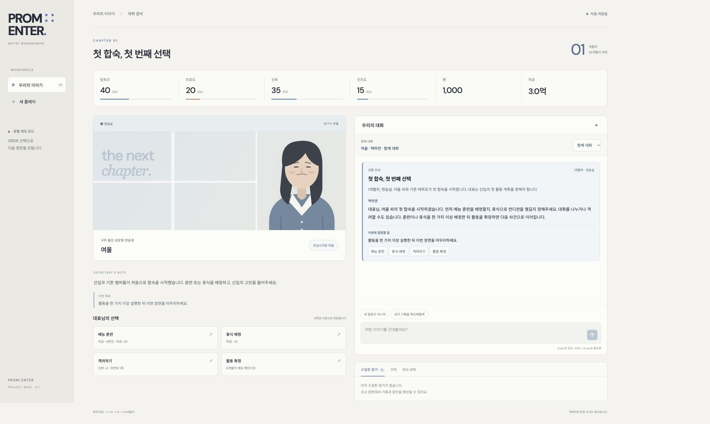
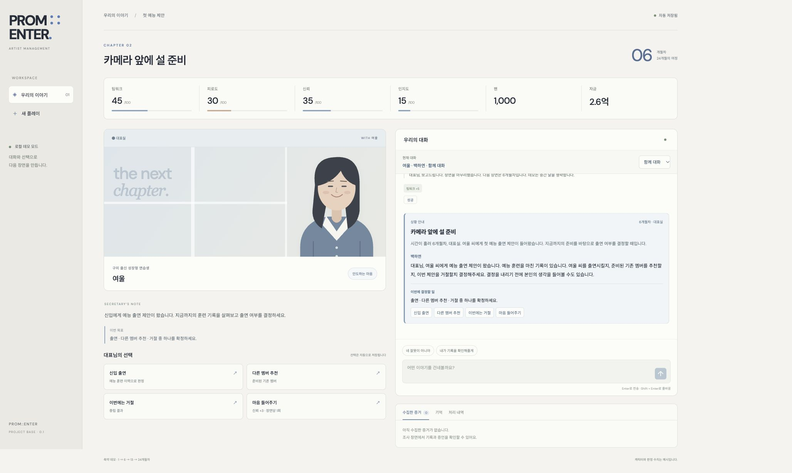

# 첫 시작과 사건 진입 안내

이전에는 사건을 마무리한 턴의 대사만 표시하고 새 사건의 브리핑은 왼쪽 카드만 갱신했습니다. 이제 첫 캐릭터 선택과 각 사건 진입에 대화창 도입 안내를 제공합니다.





## 안내 내용과 출처

`backend/app/content/event_openings.json`은 기존 축약 사건의 공개 브리핑·목표·허용 선택지를 도입 문장으로 작성한 자료입니다. 새로운 과거사나 숨겨진 증거·결말을 추가하지 않습니다. 1·6·13·24개월차에 시간·장소·상황을 설명하고 백하연이 첫 결정을 안내합니다. 프로듀서 원문 전체의 구현을 뜻하지 않습니다.

캐릭터 이름은 현재 프로필을 사용합니다. 6개월차 안내의 훈련 여부는 서버의 실제 `training_history`에서 가져옵니다. 훈련 없이 휴식만 했다면 훈련 완료를 주장하지 않습니다. 조사 도입은 확인할 수 있는 자료의 종류만 설명하며, 획득하지 않은 증거의 내용은 제공하지 않습니다. 계약 도입에서는 결말이 이미 정해진 것처럼 말하지 않습니다.

도입은 서버가 즉시 구성하므로 생성·조회·사건 전환에 추가 모델 호출을 만들지 않습니다. 후속 대사와 입력 해석에는 `event_opening`으로 현재 공개 상황을 제공합니다. 이미 끝난 사건의 결과 대사와 엔딩 대사에는 새 도입을 섞지 않습니다. 도입을 참조하는 대사는 현재 도입 ID를 인용할 수 있지만, 아직 진입하지 않은 사건의 도입 ID는 거부합니다.

## API와 저장

생성·조회 응답의 `event_openings`, 턴 응답의 `game.event_openings`를 사용합니다.

```json
{
  "event_openings": [{
    "id": "stable-opening-uuid",
    "event_id": "m06_variety",
    "after_turn_id": "the-turn-that-finished-training",
    "month": 6,
    "title": "카메라 앞에 설 준비",
    "scene": "대표실",
    "narration": "시간이 흘러 6개월차, 대표실. ...",
    "messages": [{"character_id": "baek_hayeon", "name": "백하연", "text": "대표님, ..."}],
    "goal": "출연 · 다른 멤버 추천 · 거절 중 하나를 확정하세요.",
    "choices": [{"id": "accept_offer", "label": "신입 출연"}]
  }]
}
```

- 처음의 `after_turn_id=null` 안내는 사용자 대화 앞에 표시합니다.
- 사건 전환 안내는 이전 사건의 결과 턴 뒤, 다음 사용자 발언 앞에 표시합니다. 결과 턴의 `event_id`는 끝난 사건을 계속 가리킵니다.
- 안내는 `State.event_openings`에 저장합니다. 플레이 생성 시 최초 안내를 저장하고, 전환 시 다음 안내를 상태·결과 턴과 같은 SQLite 트랜잭션에서 저장합니다.
- 게임과 사건으로 결정되는 안정적인 ID를 사용하며 현재 선형 시나리오에서 사건마다 한 번만 추가합니다. 재시도·동시 요청·새로고침은 중복 생성하지 않습니다.
- 생성이나 검증 실패, DB 충돌 시 미래 사건의 안내를 저장하지 않습니다.

도입을 일반 사용자 턴으로 저장하지 않으므로 기존 턴 순서·요청 캐시·행동 근거 판정을 유지합니다. 별도 사용자 발언이나 실제 활동 완료로 해석해서 보상을 주지 않습니다. 도입 문구와 스냅샷의 선택지는 안내용이며, 실행 가능한 활동과 사용 여부는 현재 `game.event.actions`를 따릅니다.

## 이전 플레이 복원과 화면

예전 저장에 필드가 없으면 빈 목록으로 읽고, 현재 사건의 누락된 안내를 조회 응답에서 구성합니다. 해당 사건의 첫 사용자 턴 이전으로 위치를 복원합니다. 조회로 DB를 수정하지 않으며 다음 정상 쓰기 때 같은 ID로 저장합니다. 새 플레이를 만들 필요가 없습니다.

프런트는 대화 타임라인 안에 도입 카드를 배치합니다. 첫 로딩·사건 전환·새 안내 추가 후 레이아웃이 완성된 시점에 대화창을 끝으로 이동시켜 안내가 아래에 가려지지 않게 했습니다. 도입은 서버 데이터이므로 데모·실제 모델 모드 모두 표시됩니다.

문구를 수정하면 백엔드를 재시작합니다. 새로 진입하는 안내에 수정 내용이 적용되고 이미 저장된 안내는 당시 스냅샷을 유지합니다. 자료에 없는 미래 사건을 추가할 경우에도 기본 브리핑·목표로 안내를 구성하는 fallback을 둡니다.

## 검증

첫 생성 시 사용자 입력·모델 호출 없이 안내 제공, 네 사건의 상황·선택지, 실제 훈련 여부 반영, 전환 뒤 안내 위치, 재시도·동시 전환 중복 방지, 실패 시 원복, 이전 저장의 조회·쓰기 복원과 현재/미래 도입 인용 권한을 테스트합니다.

Chrome에서 여울 선택 직후 첫 합숙 안내 → 예능 훈련·활동 확정 → 6개월차 안내 → 새로고침 후 중복 없는 복원 → 13개월차 안내와 자동 스크롤을 확인했습니다. 실제 모델 후속 대화에서도 현재 예능 제안과 훈련 이력을 설명했고, 미확인 개인 사정으로 회피하지 않았습니다. 로컬 표본은 Git에서 제외한 `backend/data/event-opening-review-20261103/followup.json`입니다.
